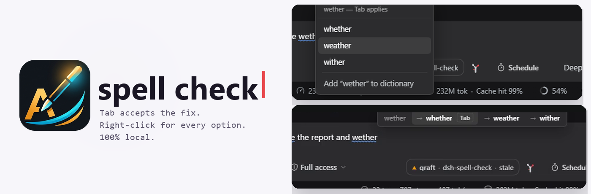
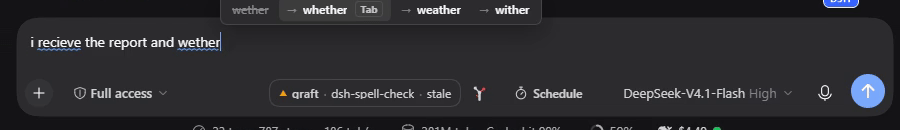
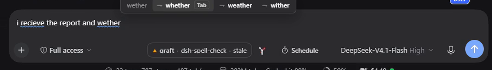
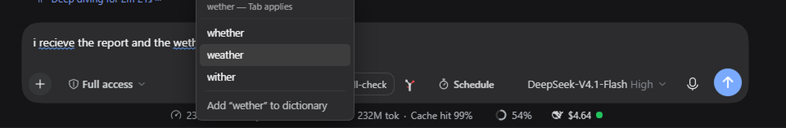

<picture>
  <source media="(prefers-color-scheme: dark)" srcset="assets/banner-dark.png">
  
</picture>

<br>

# dsh-spell-check

English | [中文](README.zh-CN.md)

      

A [DeepSeek Harness](https://github.com/deepseek-ai/deepseek-harness) plugin that spell-checks the composer the way Chrome does: the word you are typing is checked as you type it, and fixing it never takes your hands off the keyboard.

- **A strip above the caret** while you type, offering the correction. **Tab** accepts it. Escape dismisses, the arrow keys move between alternatives, `1`–`9` jump straight to one, and clicking an entry works too.
- **Right-click any word** for a menu with every ranked alternative plus *Add to dictionary* — the same list, on the word you pointed at rather than the one behind the caret.
- **Nothing leaves your machine.** No network calls, no telemetry, no model. The dictionary ships with the plugin.

Everything is local: 20,000 frequency-ranked English words plus ~730 curated misspellings, matched with Damerau-Levenshtein so `atuo → auto`, `theh → the` and `recieve → receive` all count as one edit rather than two.

## Install

```sh
dsh plugin --profile web add dsh-spell-check
```

Restart dsh. The checker is on from then on — there is no chip, no toggle, and nothing added to the composer bar.

### In the desktop app

Open **Plugins** in the sidebar, click **Add plugin**, paste the repository address and install:

```
https://github.com/adithyanraj03/dsh-spell-check
```

## What you get

### Type, then press Tab

The word under the caret is checked as you type. When it is wrong, a strip appears directly above it:



**Tab** replaces the word and leaves the caret after it, so a second Tab corrects the *next* word rather than repeating the last one. The strip stays put while your pointer is over it, so it can be clicked as well as tabbed to.

Misspelled words in the draft carry a blue wavy underline — the plugin's own marking, with Chromium's red squiggles switched off, so there is exactly one spellchecker in the box:



### Right-click a word

For any word in the draft, right-click opens the full list — including words that are further away than the one you would tab to:



Picking a word replaces it in place. The menu appears **only** for a misspelled word that has suggestions; everywhere else the normal menu still opens, so Cut/Copy/Paste are never taken away.

### What it deliberately ignores

- **Real words.** `hoe` is not corrected to `how`, `form` is not corrected to `from`. A word in the dictionary is left alone — that rule is what separates this from the autocorrect people switch off.
- **Acronyms**, `ALL_CAPS` tokens, and anything containing digits.
- **Code.** Inside a fenced ```` ``` ```` block in the draft, the checker stays silent.
- **`@mentions` and `/commands`**, because a token has to start with a letter to be a word.

### Learned words

*Add to dictionary* teaches the local engine immediately. The word is also handed to the host half, which persists it under `~/.dsh/storages/spell-check.json` so it survives a restart.

## Configuration

Nothing to configure. There is no row to edit and no flag that turns off a feature you might want.

## Requirements

| dsh | status |
|---|---|
| `0.2.1-rc.3` | tested — embedded dictionary, strip, Tab, right-click menu and learned words |
| `0.2.0` | expected to work; the client half only needs `slots`, `conversation` and `sessions` |

- Node 22+

## Changing the dictionary

The word list is data, not code. Drop a plain text file at `assets/words-extra.txt` — one word per line — and run `npm run build`. Common `SCOWL`, `Hunspell` (`en_US.dic`) and `wordfreq` exports all reduce to that shape, so any of them can be plugged in without touching the source. Lines with an affix marker (`walk/ed`) are reduced to the headword.

Options, and what each costs:

| Source | Licence | Size | Trade-off |
|---|---|---|---|
| current list (nltk corpora, frequency-ranked) | same as this repo | 20,000 | fast, tuned for typos, catches `wether → whether` |
| [SCOWL](http://wordlist.aspell.net/) size 60 | permissive, mixed | ~95,000 | far better coverage of real words, but rare-valid words stop being corrected (`wether` is a real word: a castrated ram) |
| [Hunspell](https://github.com/wooorm/nspell) `en_US` + `nspell` | LGPL/MPL (dictionary), MIT (nspell) | ~50,000 stems + affixes | closest to what Chrome actually uses; needs an affix engine, so it is a dependency rather than a word list |
| [wordfreq](https://github.com/rspeer/wordfreq) top-N | Apache-2.0 | any | best frequency ordering, which is what decides which suggestion is offered first |
| [google-10000-english](https://github.com/first20hours/google-10000-english) | public domain derivative | 10,000 | tiny and frequency-ordered; what people usually mean by "Google's list" |

A bigger dictionary is not automatically better here. Every valid word you add is a typo the checker will stop offering, so the useful expansion is usually **more misspellings** (the curated map in [src/engine.js](src/engine.js)), not more words.

## How it works

The browser half holds the whole engine. `scripts/build-client.mjs` strips the `export` keywords from [src/engine.js](src/engine.js) and splices it, together with the word list, into [src/client.js](src/client.js) — so there is one copy of the matching rules and no round trip per keystroke. The host half imports that same file and exists only to persist learned words.

Two things about this composer are worth knowing if you extend it:

- **It is Lexical, and typing does not emit an `input` event.** Lexical calls `preventDefault()` on `beforeinput`, so the plugin listens to `selectionchange`, `beforeinput` and `keyup` instead. A listener on `input` alone is silently deaf.
- **`execCommand` cannot be trusted to replace text.** Lexical applies edits against its own selection, not the DOM range the page hands it, so a `insertText` aimed at a word lands at the start of the draft. Replacements go through the composer's own API — `conversation.input.for(scope).setDraft(text)` — which sets the model directly.

## Tests

```sh
npm test
```

129 checks, no network and no browser required:

| suite | covers |
|---|---|
| `scripts/check-styles.mjs` | the stylesheet is composed of well-formed rules — an orphaned declaration silently kills every rule after it |
| `scripts/test-engine.mjs` | matching, ranking, case handling, acronym and code exclusion, no duplicate suggestions |
| `scripts/test-host.mjs` | the shipped dictionary loads, the service answers, learned words persist |
| `scripts/test-client.mjs` | the bundle loads through dsh's module loader, registers one seat, attaches and detaches its listeners, and renders nothing in the composer bar |

## License

MIT
