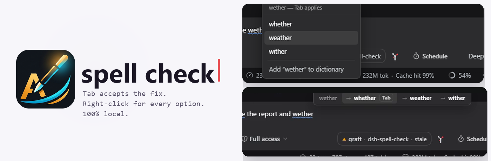
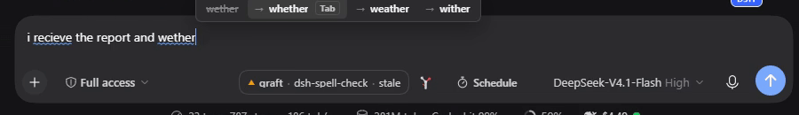
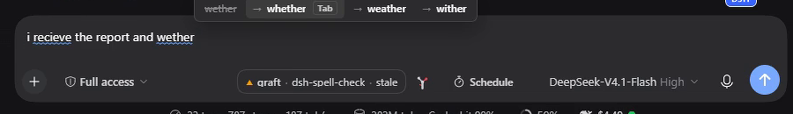
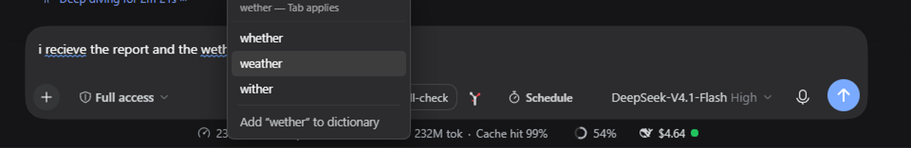

<picture>
  <source media="(prefers-color-scheme: dark)" srcset="assets/banner-dark.png">
  
</picture>

<br>

# dsh-spell-check

[English](README.md) | 中文

      

一个 [DeepSeek Harness](https://github.com/deepseek-ai/deepseek-harness) 插件，像 Chrome 那样给输入框做拼写检查：正在输入的词会边打边查，改错时手不用离开键盘。

- **光标上方出现建议条**，**Tab** 接受它。Esc 关闭，方向键在候选中移动，`1`–`9` 直接选中，也可以鼠标点击。
- **右键任意单词**，弹出按相关度排序的全部候选，外加「加入词典」——同一份列表，作用在你指的那个词上，而不是光标后面的词。
- **一切都在本机完成。** 没有网络请求，没有遥测，没有模型。词典随插件一起发布。

词典是 20,000 个按词频排序的英文词，加上约 730 条手工整理的常见拼写错误；匹配用 Damerau-Levenshtein 距离，所以 `atuo → auto`、`theh → the`、`recieve → receive` 都只算一次编辑，而不是两次。

## 安装

```sh
dsh plugin --profile web add dsh-spell-check
```

重启 dsh 即生效。没有开关，没有状态芯片，输入栏不会被加入任何东西。

### 桌面版

侧栏打开 **Plugins** → **Add plugin**，粘贴仓库地址后安装：

```
https://github.com/adithyanraj03/dsh-spell-check
```

## 用法

### 边打边查，Tab 接受

光标所在的词会随输入被检查。判断为错误时，它上方会出现一条建议：



**Tab** 会替换该词，并把光标留在替换后的位置，所以紧接着再按一次 Tab 修的是**下一个**词，而不是重复上一个。鼠标移到建议条上时它不会消失，因此点击同样可用。

草稿中的错词带有蓝色波浪下划线——这是插件自己的标记，Chromium 的红色波浪线已关闭，输入框里只有一套拼写检查：



### 右键菜单

对草稿中任意单词点右键，会列出完整的候选——包括比 Tab 那条更远的词：



只有当这个词拼错且存在候选时，菜单才会接管右键；其余情况仍是系统菜单，剪切/复制/粘贴不会被拿走。

### 刻意不管的东西

- **正确的词。** `hoe` 不会被改成 `how`，`form` 不会被改成 `from`。词典里有的词一律不动——这条规则正是它和那种让人关掉的自动更正的区别。
- **缩写词**、全大写词，以及含数字的内容。
- **代码。** 草稿里围栏代码块（```` ``` ````）内部保持沉默。
- **`@提及` 和 `/命令`**，因为一个词必须以字母开头才算词。

### 学过的词

「加入词典」会立刻在本机引擎生效，同时交给宿主半边持久化到 `~/.dsh/storages/spell-check.json`，重启后仍然有效。

## 换词典

词表是数据，不是代码。把纯文本文件放到 `assets/words-extra.txt`（每行一个词）然后 `npm run build` 即可。`SCOWL`、`Hunspell`（`en_US.dic`）和 `wordfreq` 的导出格式都能直接放，带词缀标记的行（`walk/ed`）会取词干。

| 来源 | 许可 | 规模 | 代价 |
|---|---|---|---|
| 当前词表（nltk 语料，按词频排序） | 与本仓库相同 | 20,000 | 针对错字调过，能抓到 `wether → whether` |
| [SCOWL](http://wordlist.aspell.net/) size 60 | 宽松，混合 | 约 95,000 | 覆盖更多真词，但 `wether` **本身**是个真词（去势的公羊），于是不再被纠正 |
| Hunspell `en_US` + `nspell` | 词典 MPL/LGPL，nspell MIT | 约 50,000 词干 + 词缀 | 最接近 Chrome 实际使用的方案；需要词缀引擎，属于依赖而非词表 |
| [wordfreq](https://github.com/rspeer/wordfreq) 取前 N | Apache-2.0 | 任意 | 词频排序最好，而排序决定了推荐哪个候选 |

词典更大不一定更好：每增加一个「合法的词」，就少纠正一类错字。真正值得扩充的通常是**错拼表**（[src/engine.js](src/engine.js) 里手工维护的那份），而不是词表本身。

## 实现要点

浏览器半边自带整个引擎。`scripts/build-client.mjs` 去掉 [src/engine.js](src/engine.js) 里的 `export` 关键字，连同词表一起拼进 [src/client.js](src/client.js)——所以匹配规则只有一份，每次按键也不需要往返一次宿主。宿主半边 import 同一个文件，只负责持久化学过的词。

这个输入框有两个坑，改这块代码前值得知道：

- **它是 Lexical，打字不会触发 `input` 事件。** Lexical 对 `beforeinput` 调了 `preventDefault()`，所以插件监听的是 `selectionchange`、`beforeinput` 和 `keyup`。只听 `input` 会安静地完全失效。
- **`execCommand` 不能用来替换文字。** Lexical 按它自己的选区应用编辑，不认页面给它的 DOM Range，于是针对某个词的 `insertText` 会插到草稿开头。替换走输入框自己的接口 `conversation.input.for(scope).setDraft(text)`，直接改模型。

## 测试

```sh
npm test
```

129 项检查，不需要网络也不需要浏览器：

| 套件 | 覆盖 |
|---|---|
| `scripts/check-styles.mjs` | 样式表由完整规则组成——一条落单的声明会让它之后的全部规则失效 |
| `scripts/test-engine.mjs` | 匹配、排序、大小写、缩写与代码排除、候选不重复 |
| `scripts/test-host.mjs` | 随包词典能加载、服务能回答、学过的词会持久化 |
| `scripts/test-client.mjs` | 通过 dsh 的模块加载器装载、只注册一个座位、监听器能挂上也能摘掉、输入栏里不渲染任何东西 |

## 许可

MIT
