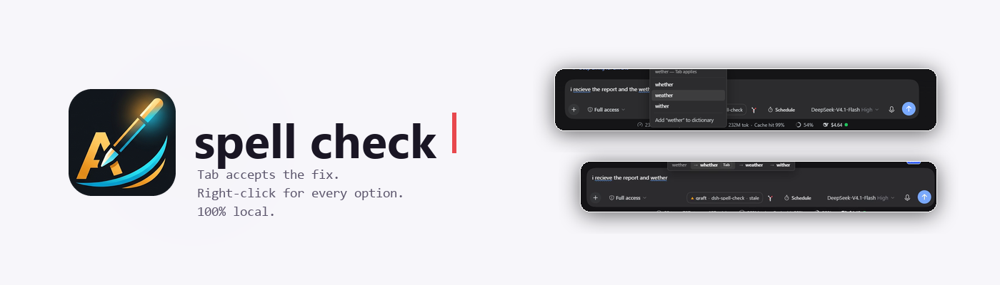
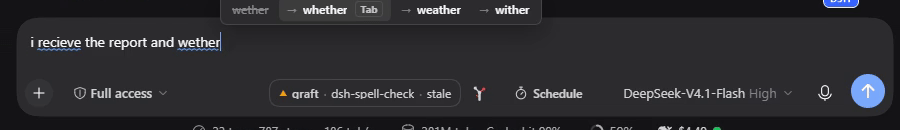
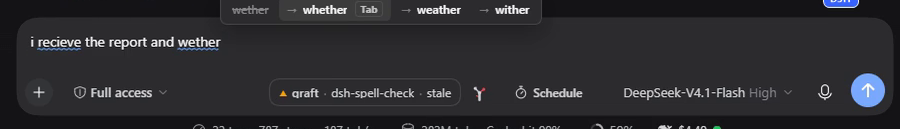
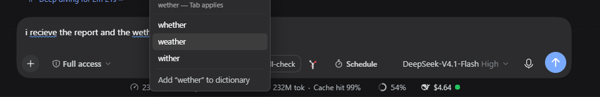

<picture>
  <source media="(prefers-color-scheme: dark)" srcset="assets/banner-dark.png">
  
</picture>

# dsh-spell-check

A [DeepSeek Harness](https://github.com/deepseek-ai/deepseek-harness) plugin that spell-checks the composer the way Chrome does — the word you are typing is checked as you type it, and fixing it never takes your hands off the keyboard.

[View on GitHub](https://github.com/adithyanraj03/dsh-spell-check){: .btn }

      

---

## Install

```sh
dsh plugin --profile web add dsh-spell-check
```

Restart dsh. The checker is on from then on — no chip, no toggle, nothing added to the composer bar.

In the desktop app: **Plugins → Add plugin**, paste `https://github.com/adithyanraj03/dsh-spell-check`, install.

---

## What it does

### Type, then press Tab

The word under the caret is checked as you type. When it is wrong, a strip appears directly above it:



Misspelled words carry a blue wavy underline - the plugin's own marking, with Chromium's red squiggles switched off:



**Tab** replaces the word and leaves the caret after it, so a second Tab corrects the *next* word rather than repeating the last. Escape dismisses, the arrows move between alternatives, `1`–`9` jump to one, and clicking an entry works too.

### Right-click any word

The full ranked list, on the word you pointed at:



The menu opens **only** for a misspelled word that has suggestions. Everywhere else the normal menu still appears, so Cut/Copy/Paste are never taken away.

### What it leaves alone

- **Real words.** `hoe` is not corrected to `how`, `form` is not corrected to `from`. That rule is what separates this from the autocorrect people switch off.
- **Acronyms**, `ALL_CAPS`, and anything with digits.
- **Code.** Silence inside a fenced block in the draft.
- **`@mentions` and `/commands`.**

---

## Local by construction

20,000 frequency-ranked English words plus ~730 curated misspellings, matched with Damerau-Levenshtein so `atuo → auto`, `theh → the` and `recieve → receive` each count as a single edit rather than two.

No network calls, no telemetry, no model. The dictionary ships inside the bundle — `scripts/build-client.mjs` splices [src/engine.js](https://github.com/adithyanraj03/dsh-spell-check/blob/main/src/engine.js) and the word list into the client half, so the matching rules exist once and a keystroke costs nothing.

---

## Two things this composer taught us

- **It is Lexical, and typing does not emit an `input` event** — Lexical calls `preventDefault()` on `beforeinput`. The plugin listens to `selectionchange`, `beforeinput` and `keyup`; a listener on `input` alone is silently deaf.
- **`execCommand` cannot be trusted to replace text.** Edits are applied against Lexical's own selection, not the DOM range the page supplies, so an `insertText` aimed at one word lands at the start of the draft. Replacements go through `conversation.input.for(scope).setDraft(text)`.

---

## Requirements

| dsh | status |
|---|---|
| `0.2.1-rc.3` | tested — strip, Tab, right-click menu, learned words |
| `0.2.0` | expected to work; the client half needs only `slots`, `conversation`, `sessions` |

- Node 22+

---

Licensed MIT. Issues and pull requests at [github.com/adithyanraj03/dsh-spell-check](https://github.com/adithyanraj03/dsh-spell-check).
